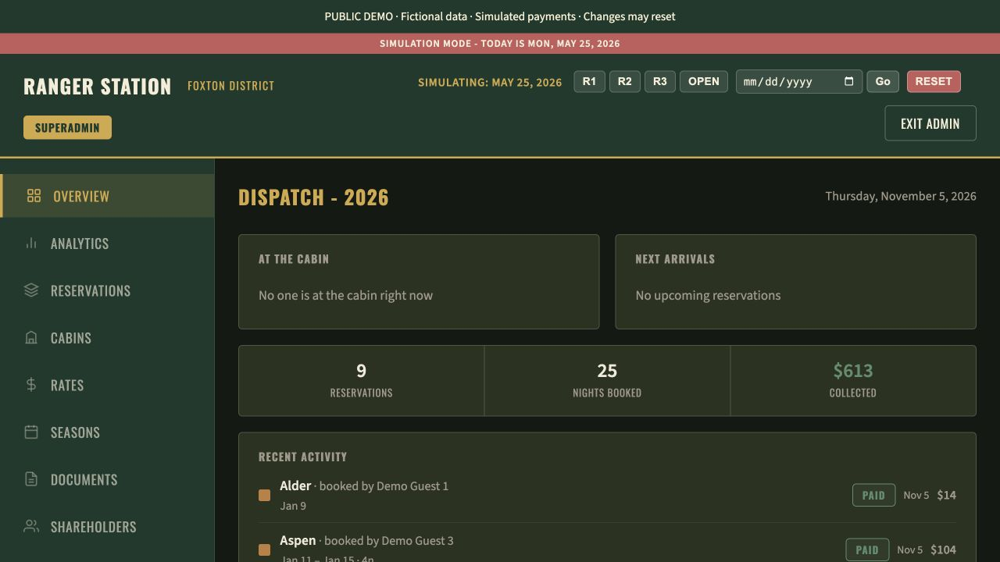
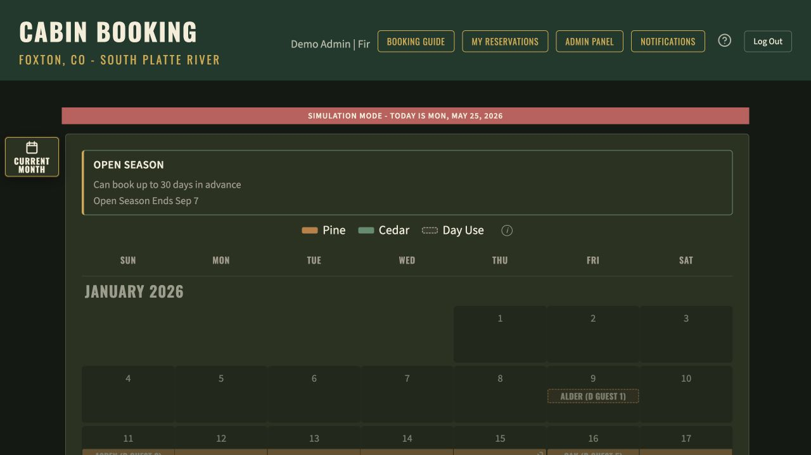
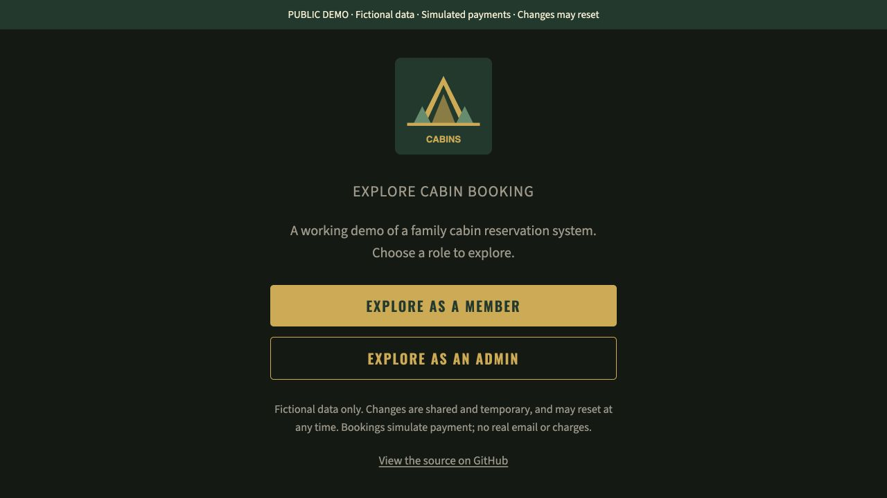

# Cabin Booking

A full-stack reservation system for shared cabin ownership. It handles the rules that make shared scheduling more involved than a typical booking calendar: rotating priority windows, seasonal night limits, access across ownership shares, guest fees, and cancellations that affect both availability and payments.

**React 19 · TypeScript · Bun · Python · FastAPI · SQLAlchemy · PostgreSQL · Stripe · Resend**

**[Explore the live demo](https://cabin-booking-public.vercel.app)** - choose a member or administrator role. The demo uses fictional data and simulated payments; changes are temporary.

This repository is a public portfolio edition of a private application. It preserves the application logic and regression tests while using fictional members, cabins, and reservations.

## Why I built it

I built this application for my wife's family property in Foxton, Colorado, which has been in her family since the late 1800s. Ownership is divided among nine shares, so scheduling a stay means coordinating access to a place shared across generations.

I met with the shareholders and presented a working demo, showing how the site could improve on their existing reservation system. They approved moving forward, and I brought the application into use for the 2026 booking season.

The application turns their shared-use rules into a booking workflow: each share gets its priority window, seasonal limits govern reservations, and members can see availability and manage their stays. Taking it from a proposal to a system the family uses meant working directly with the people relying on it, earning their approval, and delivering the booking, access, and payment features they needed.

## What it does

Members can browse a multi-month calendar, book overnight or day-use stays, manage guests, and review their reservations. Administrators manage cabins, ownership shares, booking seasons, rates, payments, and reporting.

- **Rule-based booking:** Priority and reverse-priority rounds, per-round limits, seasonal allowances, and open booking periods.
- **Access control:** Session authentication, email sign-in links, invitations, administrative roles, and explicit access to additional ownership shares.
- **Payment lifecycle:** Stripe Checkout, webhook processing, unpaid reservation cleanup, guest adjustments, and refund policies.
- **Notifications:** Booking confirmations, reservation and booking-window reminders, and opt-in alerts when cancellations release availability.
- **Administrative tools:** Season configuration, reservation management, analytics, and date simulation for inspecting booking windows.

## Screenshots

The live demo includes a member booking calendar and an administrative dashboard for reservations, rates, shares, and booking seasons.



<details>
<summary>Booking calendar and demo sign-in</summary>

**Booking calendar:** cabin availability, seasonal rules, and reservation history.



**Demo sign-in:** explore either role without creating an account.



</details>

## Engineering highlights

### Keeping availability consistent

Reservation creation coordinates access to the relevant share and cabin rows using PostgreSQL row locks. Local SQLite development uses in-process locks because SQLite does not provide the same row-locking behavior. A dedicated regression scenario exercises concurrent booking attempts.

Start with [reservation_service.py](backend/services/reservation_service.py) and [double_booking_race_regression.py](backend/tests/double_booking_race_regression.py).

### Modeling booking rules separately from HTTP handlers

Booking rounds, share access, guest nights, fee policies, and refunds live in dedicated backend services. This keeps the rules inspectable without tracing them through UI components or route handlers. Regression scripts cover boundary cases such as same-day stays, cancellation ownership, additional-share access, and payment gating.

Start with [booking_round_service.py](backend/services/booking_round_service.py), [share_access_service.py](backend/services/share_access_service.py), and [fee_policy_service.py](backend/services/fee_policy_service.py).

### Handling asynchronous frontend data

The frontend uses a shared typed API client and a fetch cache with request deduplication, explicit invalidation, and generation tracking. Generation checks prevent an older response from overwriting data returned by a more recent refresh. Calendar utilities separately handle selection, checkout-day availability, and scroll state.

Start with [fetchCache.ts](frontend/lib/fetchCache.ts), [API tests](frontend/api/api.test.ts), and [calendar utilities](frontend/utils).

### Testing payment and notification behavior

Backend regression scripts exercise webhook handling, administrative refunds, unpaid cleanup, login-link reuse, and email recipients. Payment and email checks use mocked integrations where appropriate, allowing targeted verification without real charges or messages.

Start with [stripe_webhook_regression.py](backend/tests/stripe_webhook_regression.py), [admin_refund_regression.py](backend/tests/admin_refund_regression.py), and [cancellation_email_regression.py](backend/tests/cancellation_email_regression.py).

## Architecture

| Layer | Implementation |
| --- | --- |
| Interface | React 19, TypeScript, responsive calendar and administration views |
| Local server | Bun serves the frontend and proxies `/api` requests to FastAPI |
| API | FastAPI routers with Pydantic request and response models |
| Business logic | Python services for booking, permissions, pricing, payments, and notifications |
| Persistence | SQLAlchemy models; SQLite locally and PostgreSQL for deployment |
| Integrations | Stripe for payments and Resend for email |
| Deployment | Vercel static frontend, Python API entrypoint, and scheduled maintenance routes |

The main source directories are [`frontend/`](frontend), [`backend/routers/`](backend/routers), [`backend/services/`](backend/services), and [`backend/db/`](backend/db). Deployment routing and schedules are in [`vercel.json`](vercel.json).

## Run locally

Requires Bun and Python 3.12. No external payment or email credentials are needed for local exploration.

```sh
bun install
python3 -m venv .venv
source .venv/bin/activate
pip install -r backend/requirements.txt
cp .env.example .env.local
python backend/seed_local.py
uvicorn main:app --app-dir backend --reload
```

In a second terminal:

```sh
bun dev
```

Open [localhost:3000](http://localhost:3000). Request a sign-in link using one of these fictional accounts, then open the link printed in the backend terminal:

| Account | Email |
| --- | --- |
| Administrator | `admin@example.com` |
| Member | `alder@example.com` |

A useful walkthrough:

1. Sign in as a member and explore the Pine and Cedar cabin calendars.
2. Review the booking rules and create a reservation for an available date.
3. Sign in as the administrator to inspect reservations, rates, shares, and season settings.
4. Use the administrative date simulation to explore the demo's 2026 booking windows.

The seed creates 9 ownership shares, 2 cabins, 19 fictional accounts, and 9 reservations in `data/cabins.db`. Accounts also have the local demo password `password`; set `SEED_PASSWORD` before seeding to choose another. To reset the demo, stop the backend, delete `data/cabins.db`, and rerun the seed script. Do not deploy this demo database.

## Validation

```sh
bun run typecheck
bun run lint
bun run build
bun test frontend/api/api.test.ts frontend/utils/calendarSelection.test.ts
python backend/tests/login_link_uses_regression.py
python backend/tests/cancellation_email_regression.py
python backend/tests/booking_window_reminder_email_regression.py
```

These checks passed during preparation of this public edition, along with demo seeding and an API smoke check for login, session authentication, and cabin listing. Additional scenarios live in [`backend/tests/`](backend/tests); some require a running local backend and modify demo data. This does not imply that the entire regression collection or live third-party integrations were validated.
